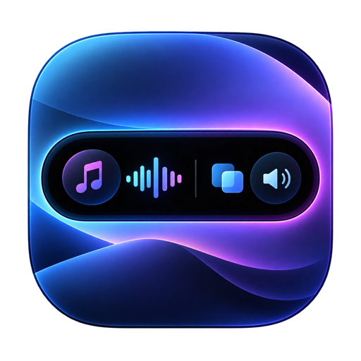
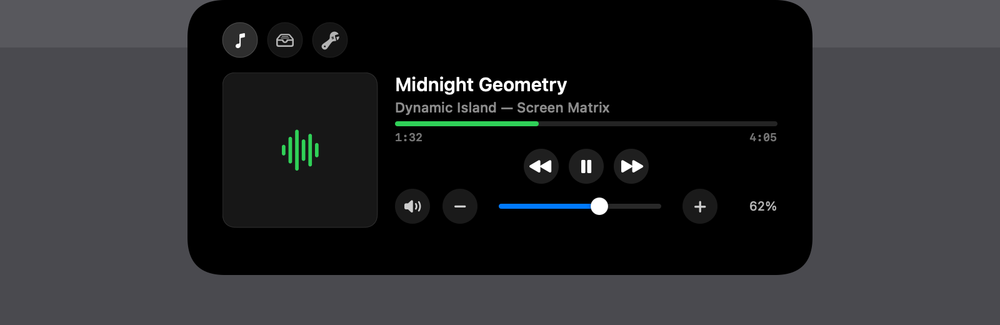
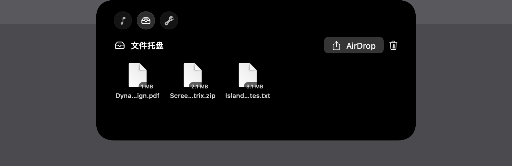

# Dynamic Island



[](https://github.com/qyt1340272051-design/DynamicIsland/actions/workflows/ci.yml)

一个贴合 Mac 刘海区域的开源 SwiftUI 菜单栏应用。提供系统音量、Apple Music、文件托盘、AirDrop、内置计时和可安装插件；通过统一 Activity 展示紧凑提示与展开工具。

> 当前源码为 App `0.6.0` 开发预览，候选标签 `v0.6.0-beta.2`（build 4）；下载以对应 Release 实际资产为准。测试 DMG 使用 ad hoc 签名，未经 Apple 公证，不是 Developer ID 正式安装包。首次运行可能被 macOS 拦截；请先核对可信来源和 SHA-256，再按下方步骤手动批准。插件系统仍保留新作者独立体验与跨设备验收，不代表整个 Plugin 1.0 已验收。

## 界面预览

以下是 0.5.0 时期由屏幕矩阵工具生成的历史模拟图，仅用于介绍布局；不代表 0.6.0 当前插件界面或真实设备兼容性验收。历史图片位于 [`docs/images/`](docs/images/)。

### Apple Music



### 文件托盘



### 紧凑播放状态


## 当前功能

- 刘海顶部 `NSPanel`：悬停延迟展开、拖入文件展开、状态切换动画与触觉反馈。
- 系统音量：实时读取和调节默认输出设备音量，支持增减、滑杆与静音。
- Apple Music：读取封面、曲名、歌手和播放进度，支持播放、暂停、上一曲、下一曲和实时拖动进度条；悬停进度条时显示拖动圆点。
- 文件托盘：把拖入文件复制到沙盒临时目录，支持锁定展开、单项移除和清空，并通过系统 AirDrop 分享面板发送。
- 内置计时：闹钟工具菜单中的「内置计时」提供秒表和可长按快速调节的倒计时。番茄钟改为独立安装的官方插件。
- 插件管理：支持 `.dip` 导入、信息与权限预览、安装后停用、逐项授权、启停和卸载。发现页可主动读取正式目录，下载固定版本后进入同一安装预览。
- 官方插件：番茄钟 0.2.1 提供 15 / 25 / 45 / 60 分钟预设；GitHub 0.1.0 展示两个公开仓库的构建与 PR 状态。两款均需另外安装，不随主程序自动启用。
- 充电提示：接入电源后在刘海两侧展示充电文字、电量与填充电池图标。
- 岛内退出：展开后可点击电源图标关闭应用。
- 紧凑活动态：音乐播放时显示微缩封面与六点动态指示，计时运行时显示功能图标和实时数据。
- 多屏适配：按当前屏幕、刘海安全区、菜单栏可见状态和显示器变化重新计算面板位置。
- 调试矩阵：内置模拟屏幕配置，可生成 8 种屏幕环境、8 种界面状态的 64 张快照。
- Beta 诊断：菜单栏可复制脱敏的设备、屏幕与面板信息，并直接打开结构化反馈表单。

## 环境要求

- macOS 26.0 或更高版本
- Xcode 26.6
- 随 Xcode 提供的 Swift 6 工具链；工程当前采用 Swift 5 语言模式

刘海 MacBook 是主要使用场景；无刘海内建屏幕和外接显示器也有对应的几何回退与模拟测试。

## 快速开始

查看 [App 0.6.0 开发预览 Release](https://github.com/qyt1340272051-design/DynamicIsland/releases/tag/v0.6.0-beta.2)，以该页实际提供的 `-local.dmg`、校验和及 manifest 为准；若尚无资产，可从源码运行：

```bash
git clone https://github.com/qyt1340272051-design/DynamicIsland.git
cd DynamicIsland
open DynamicIsland.xcodeproj
```

在 Xcode 中选择共享 scheme `Dynamic Island`，目标选 `My Mac`，按 `Command-R`。应用使用 `LSUIElement` 作为菜单栏配件启动，不会显示普通主窗口。鼠标移入屏幕顶边的岛以展开；菜单栏图标提供显示、隐藏、插件管理、诊断与退出。

详细操作见 [使用说明](docs/USAGE.md)；Xcode、命令行编译、测试和本地打包步骤见 [编译说明](docs/BUILDING.md)。

测试 DMG 的首次安装：下载后核对随附的 SHA-256，把 `Dynamic Island.app` 从 DMG 拖到“应用程序”，尝试打开。若 macOS 拦截，请在确认文件可信后前往“系统设置 > 隐私与安全性”，点击“仍要打开”，再确认“打开”。这是未公证构建的手动放行，不代表 Apple 已验证其安全性；具体步骤见 [Apple 官方说明](https://support.apple.com/zh-cn/102445)。受设备管理策略限制时可能无法放行。

命令行快速编译：

```bash
xcodebuild build \
  -project DynamicIsland.xcodeproj \
  -scheme 'Dynamic Island' \
  -configuration Debug \
  -destination 'platform=macOS'
```

## 安装官方插件

1. 点击屏幕右上角菜单栏的岛形小图标，打开「插件管理…」，再选择「发现」。
2. 点击「刷新目录」，选择番茄钟或 GitHub 的「下载并查看」。打开发现页本身不会联网。
3. 确认目录中的最低 Host 与来源，核对安装预览中的名称、版本和权限，再点「安装插件」。安装后保持停用，不会自动运行或授予权限。
4. 回到插件管理，阅读每项权限说明，按需要单独授权，再点「启用插件」。启用本身不会批准任何权限；拒绝的能力保持不可用。
5. 展开刘海，点击闹钟图标，从工具菜单选择已启用的插件。

也可从[官方插件包 Release](https://github.com/qyt1340272051-design/DynamicIsland/releases/tag/plugins-0.6.0)下载 `.dip`，使用「导入插件」安装。番茄钟只请求保存设置的 `storage.local`；GitHub 分别请求 `network`、`storage.local`、`links.open`。没有 Token 输入或私有仓库支持。详细操作与拒绝权限后的行为见[使用说明](docs/USAGE.md#插件管理与官方插件)。

目录只提供发现元数据，不证明发布者身份。只安装你信任的代码；代码或权限声明改变后需要重新确认授权，没有自动安装、自动升级或自动授权。

## 权限说明

- **Apple Music 自动化**：首次读取或控制音乐时，macOS 会请求允许“Dynamic Island”控制“音乐”。拒绝后可前往“系统设置 > 隐私与安全性 > 自动化”重新开启。
- **用户选择的文件**：文件托盘使用沙盒的用户所选文件读写权限；导入内容会复制到应用临时托盘目录。
- **AirDrop**：分享由系统 `NSSharingService` 提供，实际可用性取决于当前 Mac 的 AirDrop 状态。

应用启用 App Sandbox，并声明文件选择、Apple Events、网络客户端及 JavaScriptCore JIT 所需能力。插件只能通过 Host 的受限接口申请服务；插件权限是应用内决策，JavaScriptCore 运行于主应用进程，不能当作每个插件独立的操作系统安全边界。

## 工程结构

| 区域 | 主要文件 | 职责 |
| --- | --- | --- |
| 应用入口 | `DynamicIslandApp.swift` | 菜单栏生命周期、服务装配与 accessory 模式 |
| 面板 | `IslandPanelController.swift`、`IslandPanelGeometry.swift` | `NSPanel` 创建、命中区域、屏幕顶边定位和状态尺寸 |
| 状态 | `IslandViewModel.swift` | 展示状态、服务调用、悬停与活动态协调 |
| 界面 | `IslandView.swift`、`IslandTimerToolsView.swift` | 音乐、文件、音量、计时工具和紧凑态 UI |
| 系统服务 | `DynamicIsland/Services/` | CoreAudio、Apple Music、文件托盘、AirDrop 和触觉反馈 |
| 屏幕适配 | `ScreenManager.swift`、`ScreenEnvironment.swift` | 多屏选择、拓扑变化和模拟环境 |
| Beta 诊断 | `DynamicIsland/Diagnostics/` | 脱敏诊断报告、剪贴板与反馈入口 |
| Activity 与渲染 | `DynamicIsland/Core/Activity/`、`DynamicIsland/IslandUI/` | 活动队列、展示策略、受限节点和动作路由 |
| 插件 Host | `DynamicIsland/Plugins/` | Manifest、JavaScriptCore、权限 Broker、存储、安装和发现 |
| SDK 与目录 | `SDK/`、`Registry/` | 独立作者工具、文档、类型与固定插件下载清单 |
| 测试 | `DynamicIslandTests/` | 几何、状态机、系统服务、插件闭环和快照矩阵 |

## 验证

运行与 GitHub Actions 相同的完整测试和 Release 构建：

```bash
npm ci --prefix SDK --ignore-scripts --no-audit --no-fund
./Scripts/ci.sh
```

运行 Spaces、全屏、隐藏菜单栏、合盖和权限拒绝等稳定性场景：

```bash
./Scripts/run-stability-matrix.sh
```

生成屏幕快照矩阵：

```bash
./Scripts/generate-screen-matrix.sh
open artifacts/screen-matrix/index.html
```

生成的矩阵位于被 Git 忽略的 `artifacts/screen-matrix/`，不会污染提交。

## Beta 测试

真机公测计划覆盖有/无刘海、单/双屏、合盖外接、多种缩放以及 Apple Silicon/Intel；当前 `DI-B01` 至 `DI-B09` 均待验收。矩阵、测试步骤、隐私范围、`S0`–`S3` 问题分级与公测出口条件见 [Beta 验收手册](docs/BETA_TESTING.md)。

测试者可从菜单栏选择“复制调试信息”和“提交 Beta 反馈...”。调试报告不包含用户名、序列号、文件名或音乐元数据。

## 发布

本地可用下列命令构建通用架构测试 DMG、SHA-256 和 manifest：

```bash
RELEASE_TAG=v0.6.0-beta.2 ./Scripts/release.sh --local
```

此包采用 ad hoc 签名，未经 Developer ID 签名或 Apple 公证，可作为明确标注风险的 GitHub 预发布测试包，但不能声称可无提示双击启动。`v*` Tag 的自动打包与预发布流程见 [发布指南](docs/RELEASING.md)。

## 已知限制

- 音乐集成目前只支持 macOS 自带的 Apple Music，不支持 Spotify 等第三方播放器。
- 秒表和倒计时、官方番茄钟的业务计时不跨应用重启恢复；番茄钟可在获准后保存预设，但不会自动开始新一轮。
- SuperIsland 兼容仅覆盖已实现的简单子集，不保证任意上游插件可运行。
- 插件异常有隔离、日志与停用处理，但当前不能强制抢占无限循环 JavaScript；不要运行未知来源的插件。
- T39 新作者仅按文档独立构建安装的验收仍待完成；SDK 和官方包公开不代表该人工门槛已经通过。
- 正式 Developer ID 签名与公证需要发布团队凭据；自动更新尚未实现。
- 屏幕模拟矩阵已覆盖常见几何组合；真机 Beta 矩阵的待验证项以 `docs/beta-device-matrix.json` 为准。

## 参与开发

提交改动前请阅读 [CONTRIBUTING.md](CONTRIBUTING.md)。Bug 报告、功能建议、屏幕兼容性和 Beta 验收都有对应的结构化 Issue 模板；Pull Request 会自动校验真机矩阵、执行测试和 Release 构建。

## 许可证

本项目使用 [MIT License](LICENSE)。
