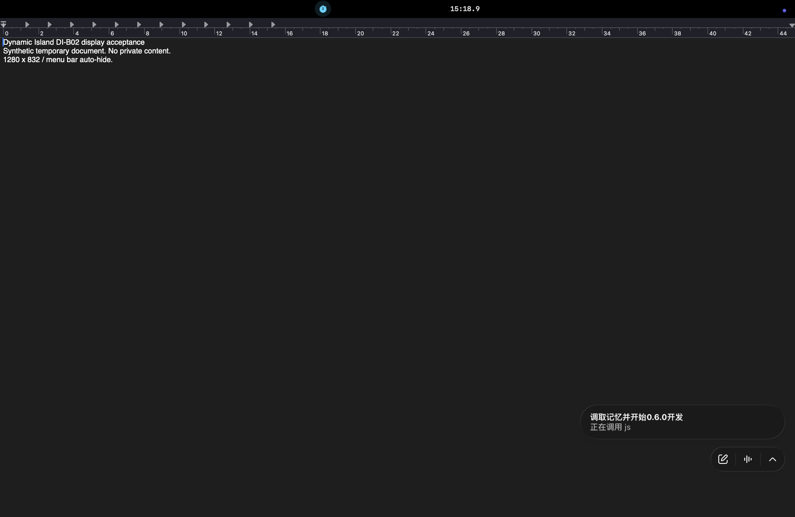

# DI-B02 非默认缩放与菜单栏自动隐藏真机验收

2026-10-22，Asia/Shanghai。**DI-B02 passed**；设备矩阵现为 **1 passed / 8 pending**。本次是原样公开的 `v0.6.0-beta.2`（App 0.6.0 / build4）在 Mac16,12 / arm64 / macOS 26.6.2（25G83）、单内建刘海屏上的场景验收。见[结构化结果](result.json)和[原始文件清单](manifest.json)。

## 构件与范围

- 公开源提交 `eacec4d1d385bc90946e8d0df1731dbd22c23428`，实际可执行文件 SHA-256 `339773f56666bcc3a514500b70d9fa6cd21a8bbdc9c1d7682e83796a1584fb92`，本轮开始时已重新核对。没有替换二进制或修改 App / Runtime / SDK。
- [公开 beta.2](https://github.com/qyt1340272051-design/DynamicIsland/releases/tag/v0.6.0-beta.2)是 ad hoc 签名、未公证 prerelease。本轮继续使用已运行的公开构件，没有新增 Gatekeeper 手动放行步骤；不是干净 Mac 首次安装或 Developer ID 验收。
- 用户已允许临时切到 1280×832／菜单栏“始终”自动隐藏，完成后恢复原 1470×956（默认）／“仅在全屏幕视图下”。

## 检查与证据来源

| 检查 | 结果与边界 |
| --- | --- |
| 实际配置 | 系统设置的[临时分辨率选中行](sources/temporary-resolution-selected.txt)和[菜单栏选中项](sources/temporary-always-menu-option.txt)分别确认 1280×832／始终隐藏。 |
| 自动定位、悬停与收起 | 用户在复制调试报告前回答“自动位置正常，展开和收起无遮挡”；[原始观察](sources/non-default-desktop-observation.json)将其与后续报告分开记录。 |
| 调试几何 | [新报告](sources/non-default-diagnostic-user-report.txt)时间为 13:23:12.649Z：frame 1280×832，安全区顶部28 pt，compact156×28，稳定容器 frame (380,592,520,240)，顶部832、中心640。 |
| 原生全屏与菜单栏 | 已有本地合成 TextEdit 文档进入和退出原生全屏，[原生菜单](sources/fullscreen-native-view-menu.txt)明确显示“退出全屏幕”。按预先说明进行移出／移入后，用户回答“刘海显示正常”。没有将这一概括回答拆写为多条独立测量。 |
| 普通桌面 Space | 用户按说明切到另一个普通桌面、移入／移出并返回，回答“已切换并返回，两边都正常；使用已有桌面”。[反馈来源](sources/fullscreen-and-space-user-feedback.json)保留原话。未新建桌面；未独立测量 Space ID。 |
| 完整物理顶边 | 另一次同配置原生全屏中，通过 macOS Screenshot 原生界面完成全屏静态截图。[原始 PNG](captures/physical-fullscreen-compact.png)为2560×1664，完整顶边上左计时图标和右15:18.9均可见，菜单栏隐藏。 |
| 恢复与停止 | [分辨率](sources/restored-resolution-selected.txt)、[菜单栏](sources/restored-menu-bar-option.txt)已恢复并核对选中状态；[秒表](captures/stopwatch-reset.txt)为“准备计时00:00.0”且按钮为“开始”。[清理记录](sources/cleanup.json)确认退出全屏、关闭未改动的合成文档和系统设置，App继续可用。 |

## 证据边界与隐私

复制调试信息的生产入口会先调用 `screenManager.refresh()`（[源码](../../../../DynamicIsland/DynamicIslandApp.swift)）。因此“自动定位正常”依据复制前的现场用户观察；报告证明复制时的实际几何，不单凭它推断自动刷新。默认配置的稳定容器为520×240，切换后也为520×240；容器尺寸不等于紧凑壳体或活动两翼尺寸。

首次原生全屏时，秒表在用户悬停展开后才启动，没有把初始移出期间描述为已运行两翼。随后 App 的展开／收起捕获与普通 Space 反馈分别记录。完整物理 PNG 来自第二次静态全屏，不冒充首次移出／返回的连续录像。窗口 JPEG／AX 只证明对应 App 内容，不替代物理顶边截图。早期反馈 JSON 内“尚未收到物理截图”是当时的阶段状态；后来取得的系统截图见[获取记录](sources/physical-screenshot-acquisition.json)，并非用户粘贴截图。

所有媒体保留原始字节，未裁切、重绘或修改。物理 PNG 只有合成文档、刘海及公开项目标题的任务指示；已审阅无账户、密钥或私人文件内容。系统设置只保存相关选中项文字，未发布含账户身份的完整树或截图；私有临时路径清单未纳入仓库。系统截图输出已移入证据目录，桌面无该截图遗留。

本轮未播放音乐、调整音量、授权插件或移动／删除托盘文件。DI-B01 的实际音乐、物理音量 HUD、安全清空和完整正常离开／重开序列仍保留；DI-B03–B09、干净 Mac、T39 新作者体验均未通过。本轮不实施 U02 全分辨率自适应，原计划仍为 **39 verified / 1 in progress**。
