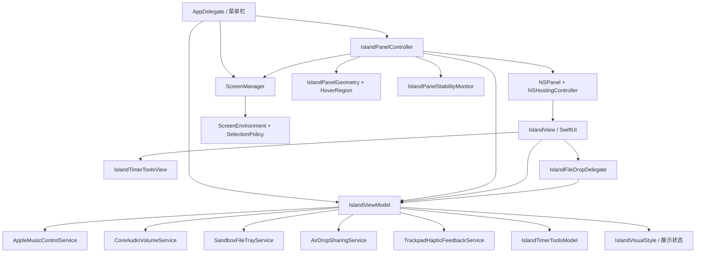

# 插件系统 Phase 0：架构审计与基线

2026-10-19 后续更新：[真实基线与早期门槛归并](t02-t08-acceptance-20261019.md)已记录普通 Release 启动、零插件空闲资源和正常退出；下文的初始 Pending 表是 2026-09-22 历史快照。当前状态以 [PROGRESS](PROGRESS.md) 为准，不追填不存在的重构前性能数据。

状态：T01 已完成静态代码审计；T02 已完成开发分支与自动化基线。真机功能和性能基线待测。

本页对应仓库内的 [开发计划](DevelopmentPlan.md) 的 T01、T02。以下描述的是 0.6.0 Activity 重构前的现状，不代表 Activity Engine 已经接入。2026-09-22 检查的分支为 `codex/dynamic-island-0.6.0`，开发基线 HEAD 为 `cb3b696`；`v0.5.0` 标签在 `2ca5a56`，Xcode 工程当前 `MARKETING_VERSION` 仍为 `0.5.0`。

## 工程与真实依赖图

Xcode 工程有两个 target：应用 `Dynamic Island` 和依赖它的测试包 `DynamicIslandTests`。应用源码在 `DynamicIsland/`，测试在 `DynamicIslandTests/`。应用以菜单栏附属程序启动，`AppDelegate` 创建状态模型、屏幕管理器及窗口控制器，然后显示一个 `NSPanel`。

| 责任 | 当前持有者和入口 | 关键约束 |
| --- | --- | --- |
| 应用生命周期和显示/隐藏 | `DynamicIslandApp.swift:27-47,93-99` 的 `AppDelegate`；`IslandPanelController.swift:46-80` 创建、显示或隐藏唯一 `NSPanel` | 业务功能目前不会直接 `show/hide` 窗口；未来插件仍不能取得窗口引用。 |
| 屏幕选择与恢复 | `ScreenManager.swift:39-94` 监听屏幕变化并选择 `activeScreen`；`IslandPanelController.swift:83-143` 计算 frame；`IslandPanelStabilityMonitor.swift:21-39` 处理 Space、唤醒、取消隐藏 | Activity 层只决定展示内容，不接管屏幕、窗口 frame 或恢复逻辑。 |
| 展开状态与用户交互 | `IslandViewModel.swift:63-69,136-303` 由 hover、拖拽、托盘锁定、计时完成推导 `presentationState` 并选择 `expandedSurface`；`IslandPanelController.swift:146-203` 以 30 Hz 检查指针 | 当前展开是交互状态，与未来 Activity 的生命周期和优先级是两个维度。 |
| UI、尺寸与动画 | `IslandView.swift:22-49,52-122,154-235` 直接读取模型并渲染 compact/expanded 内容；`IslandVisualStyle.swift:3-44` 决定 shell/content 尺寸 | 后续 Renderer 应复用 Host 的几何和动画边界，不能让插件指定窗口大小。 |
| 音乐 | `MusicControlService.swift:3-103` 定义数据和接口；`IslandViewModel.swift:498-515,603-671` 轮询、控制和更新 `nowPlaying/isPlaying` | `NowPlayingInfo` 是 `Sendable`，但含封面 `Data`；插件边界宜传资源引用或受限摘要。 |
| 音量 | `VolumeService.swift:8-25` 接口与 CoreAudio 实现；`IslandViewModel.swift:305-377,756-761` 读取、写入和监听系统事件 | 后台回调已切到 `MainActor` 后写模型。 |
| 文件托盘 | `IslandView.swift:1143-1202` 的 DropDelegate；`IslandViewModel.swift:265-295,379-429`；`FileTrayService.swift:4-28` | 拖拽临时展开和托盘持久数据不能混同为同一 Activity 结束条件。 |
| 计时器 | `IslandTimerToolsModel.swift:34-59,306-347` 持有会话和 100 ms ticker；`IslandViewModel.swift:719-754` 以 Combine 接收 session/completion | 完成提示会强制展开，后续需映射为受控的 Activity 优先级/生命周期。 |

当前没有 `IslandActivity`、`ActivityManager`、声明式 `IslandNode` 或 Provider 层，也没有 Battery、Download、AirPods 功能实现。计划中用 Music/Battery/Download 构造模型的验收项，在内置 Provider 迁移前只应作为纯数据样例验证。

## 准备迁移到 Activity Engine 的调用点

| 调用点 | 当前直接变化 | 迁移意图 |
| --- | --- | --- |
| `IslandViewModel.swift:498-515,603-624` | 音乐刷新或按钮动作直接写 `nowPlaying`、`isPlaying`、表面和错误状态 | Music Provider 以稳定 ID 发布/更新/结束持续 Activity；业务命令经 Host 路由。 |
| `IslandViewModel.swift:305-377,756-761` | 音量监听与用户输入直接写 `volume/isMuted` | Volume Provider 发布合并后的音量提示；系统音量服务继续作为数据源。 |
| `IslandViewModel.swift:379-420` 与 `IslandView.swift:1143-1195` | 导入、删除、清空文件直接改托盘状态并选中表面 | File Provider 发布托盘状态或短时导入结果；拖拽命中仍留 Host。 |
| `IslandViewModel.swift:719-754` | 计时会话/完成直接改 compact 模式、强制展开 | Timer Provider 用固定 ID 更新进度，完成时发布较高优先级提示；确认动作由 Host 处理。 |
| `IslandViewModel.swift:136-248,626-644,712-717` | hover、锁定、完成标志共同决定展开和首选表面 | 逐步把内容选择改为消费 `ActivityManager` 输出；hover 与用户锁定仍作为 Host 展示交互。 |
| `IslandView.swift:180-235` | 按 `compactTimerMode/isPlaying/expandedSurface` 直接决定视图分支 | Phase 2 的 Presentation Model 和 Renderer 接入后统一渲染；Phase 1 不先重写布局。 |
| `IslandPanelController.swift:185-203` | 用当前表面推导可见 shell 的 hover frame | Renderer 接入时改为 Host 展示快照提供尺寸；保持 panel 稳定 frame。 |

Phase 1 的最小入口是 `Core/Activity/` 下的纯数据 `IslandActivity`、有限 `ActivityPriority`、`ActivityLifecycle`，再实现主线程边界清晰的 `ActivityManager`、队列与集中展示调度。先用 Debug Provider 验证 publish/update/dismiss/end 与优先级恢复，再按计划进入 IslandNode、Renderer 和内置迁移。Activity 不包含 `AnyView`、`NSView`、`NSWindow` 或闭包；同一事件更新复用 ID。当前的 30 Hz 指针 Timer、音乐轮询及播放进度 Task、计时器 ticker 是不同业务时钟，Activity Scheduler 调度的是展示时长，不应直接改变这些时钟的行为。

## 多屏与无刘海保障

- `ScreenSelectionPolicy.swift:3-28` 支持内建、主屏、指定 display ID，并有找不到目标屏时的回退；`ScreenManager.swift:82-124` 保存物理屏与模拟屏的区分及辅助顶栏区域。
- `IslandPanelGeometry.swift` 使用辅助顶栏区域计算刘海中心；区域不存在时退回屏幕中心和菜单栏保留高度。稳定面板保持 `520 × 240` 的 Host frame，展开/紧凑内容在其中绘制。Activity/插件不改变这些坐标。
- `IslandPanelHoverRegion.swift:6-32` 以可见 shell 而非透明面板计算展开态命中范围。新增 Activity 尺寸必须继续满足这个约束。
- 自动化保护包含 `IslandPanelGeometryTests`、`IslandPanelHoverRegionTests`、`ScreenManagerTests`、`ScreenSelectionPolicyTests`、`IslandPanelStabilityMonitorTests` 和 `ScreenSnapshotMatrixTests`。真机的刘海、无刘海、外接屏、混合缩放、合盖与睡眠恢复仍按 `docs/BETA_TESTING.md` 记录，不能用模拟测试代替。

## T02 基线记录

| 项目 | 2026-09-22 记录 | 证据或下一步 |
| --- | --- | --- |
| 开发分支 | `codex/dynamic-island-0.6.0`，HEAD `cb3b696` | `git status --short --branch`、`git log -3 --oneline --decorate`。计划中的分支名是建议值，当前实际分支为此名称。 |
| v0.5.0 对照 | 标签 `v0.5.0` 指向 `2ca5a56` | 开发基线比该标签多一笔既有音乐裁切修正提交。 |
| 音乐裁切修正来源 | 开始审计时四处既有未提交改动，已独立保存为 `cb3b696`（`Fix expanded music controls clipping`）：`DynamicIsland/IslandView.swift`、`DynamicIsland/IslandVisualStyle.swift`、`DynamicIslandTests/IslandTimerShellRenderingTests.swift`、`DynamicIslandTests/IslandVisualStyleTests.swift` | 修改使音乐 shell 高度为 200、计时 shell 为 190，并固定切换栏高度；原有工作已保留，后续改造需保留该提交的行为。 |
| 自动化测试 | `./Scripts/ci.sh`：161 tests，1 skipped，0 failures | 已由本轮基线执行；脚本也运行发布配置与 Beta 矩阵校验。每阶段重复执行并保存日志或 `.xcresult`。 |
| Release 构建 | `./Scripts/ci.sh` 的 Release build passed | 当前版本号仍为 0.5.0；通过构建不代表 0.6.0 功能或真机验收完成。 |
| 启动、菜单栏与真实窗口 | Pending | 启动实际 `.app`，记录出现时间、显示/隐藏/退出及异常日志。 |
| 空闲 CPU、内存、能耗 | Pending | 在同一台 Mac、同一显示器配置下冷启动后静置 5 分钟，再用 Activity Monitor 连续观察 5 分钟的 CPU、内存和 Energy Impact；记录机型、macOS、构建号、采样时间与范围。 |
| 音乐、音量、文件、计时器操作 | Pending | 用真实 Apple Music、CoreAudio 输出设备、测试文件和各计时模式完成下方清单，并记录权限结果。 |
| 多屏、无刘海、缩放、睡眠/唤醒 | Pending | 按设备矩阵实测，记录屏幕布局、顶边截图和异常；自动化几何测试仅提供代码级保障。 |

## 每阶段可重复回归清单

1. 运行 `./Scripts/ci.sh`，记录测试总数、跳过数、失败数和 Release build 结果；若修改窗口/屏幕逻辑，再运行 `./Scripts/run-stability-matrix.sh`。`Scripts/generate-screen-matrix.sh` 可生成模拟屏幕快照供人工查看，但不替代真机。
2. 在刘海屏与至少一类无刘海屏启动应用：核对面板贴顶、紧凑态不遮挡交互、350 ms 延迟 hover、离开收起、显示/隐藏/退出。
3. 播放 Apple Music：查看封面、元信息、进度和控制按钮；拖动进度，确认远端曲目位置；拒绝自动化权限时确认错误处理和 UI 可恢复。
4. 改变真实系统音量并操作岛内按钮/滑杆/静音：确认双向同步、失败回滚和无明显跳动。
5. 拖入测试文件：确认导入、锁定后离开仍展开、删除单项、清空、AirDrop 分享；拖拽离开时恢复原展示状态。
6. 运行秒表、番茄钟和倒计时：确认紧凑展示、模式切换、完成提示、确认后收起；观察音乐页、切换栏和计时内容无裁切。
7. 在外接屏、主屏切换、无刘海设备、不同缩放、Space/全屏、隐藏菜单栏和睡眠/唤醒后重复定位与 hover 检查。
8. 重复同配置的启动与空闲资源采样，并在音乐播放及连续 Activity 更新场景记录 CPU/内存变化。以本页首次真实采样值为比较基线；采样前不填写通过状态或性能数字。

每一阶段的结果应写明 commit、机器/系统、测试命令或手工步骤、日期、状态和证据位置。`Pending` 必须保留至对应真实场景完成验证。
