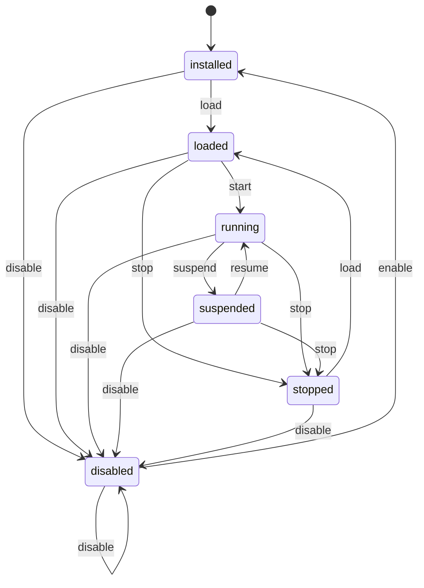

# Phase 4 — T21 Plugin Lifecycle 实现与验收

日期：2026-10-09。范围：在 T20 静态加载与持久化启用状态之上建立 Host 生命周期、执行会话、Activity 清理和系统环境接入。本阶段提供 Swift Runtime 协议与测试 Runtime；JavaScriptCore 实例、JS 参数解析和敏感能力授权继续按 T22–T28 实现。

## 状态与启用偏好

[`PluginLifecycle`](../../DynamicIsland/Plugins/PluginLifecycle.swift) 是无异步工作、无系统观察器的纯状态机。六个状态及其含义如下：

| 状态 | 含义 | 普通插件执行入口可用 |
| --- | --- | --- |
| `installed` | 已有插件身份，尚未完成当前生命周期的加载。 | 否 |
| `loaded` | Host 已保留通过 T19 验证的不可变包快照，等待启动条件。 | 否 |
| `running` | 当前执行会话有效，允许经 Host 门禁调用插件。 | 是 |
| `suspended` | 原执行会话因睡眠或低电量被撤销，等待所有暂停原因解除。 | 否 |
| `stopped` | 当前执行会话结束；需要重新加载才能启动。 | 否 |
| `disabled` | 用户禁用，执行入口已关闭。 | 否 |

表中以外的状态与事件组合返回 `invalidLifecycleTransition`，保持原状态。所有状态均接受 `disable`，重复禁用幂等；`disabled` 必须依次经过 `enable → load → start` 才能再次执行。

`PluginManager` 保存的是 `version` 和 `isEnabled` 用户偏好。运行状态与执行 token 每次 App 启动重新建立。恢复 `isEnabled: true` 只允许 Host 尝试启动；系统正在睡眠、低电量、Runtime factory 缺失或启动失败时，不能把该偏好视为 `running`。同样，主动 `stop`、环境暂停和启动失败不会改写用户的持久化启用偏好。

## Swift 生命周期 Bridge 与执行会话

[`PluginLifecycleBridge`](../../DynamicIsland/Plugins/PluginLifecycleBridge.swift) 在 `MainActor` 上组合 ActivityManager、ActionRouter 和可注入的 Runtime factory。`PluginLifecycleRuntime` 只要求三个同步 Host 接口：

| 接口 | 责任 |
| --- | --- |
| `onStart(context:) throws` | 接收本次执行会话的上下文，可通过该上下文发布 Activity 和登记动作。 |
| `onStop(reason:) throws` | 接收 `disabled`、`unloaded`、`suspended`、`stopped`、`startFailed` 或 `shutdown` 清理原因。 |
| `teardown()` | 同步撤销并取消 Runtime 自己持有的执行工作和回调资源；即使 `onStop` 抛错仍会调用。 |

启动或恢复会创建新 Runtime、新 UUID token 和新 `PluginExecutionContext`。恢复使用 `onStart`；本阶段没有额外的 `onResume`/`onSuspend` 回调。Runtime 必须使用 Validator 给出的不可变 `entrySource`；重载后新 Runtime 收到最新验证快照。

`PluginExecutionContext` 持有固定插件 ID、Host 分配的 `.plugin` source 和执行 token。`perform`、`publish`、`registerActionHandler` 每次检查 Bridge 当前注册、`isEnabled`、`running` 和 token 相等。`publish` 还检查 Activity source 与会话 source 一致。旧 Task、旧 context 和旧 action handler 在禁用、暂停、停止、重载或卸载后无法重新取得执行资格；同一个插件重新启用也使用新 token。

登记的 action handler 强持有其执行 context，因此 Runtime 可以在登记后放弃自己的 context 引用，动作仍能正常调用。生命周期清理会注销 handler，旧 context 即使被其他调用方保留也无法通过 token 门禁。`isStarting` 防止 Runtime factory 同步更新环境时重入启动；factory 返回后重新检查注册、启用与环境条件，若 factory 已触发 shutdown，则只 teardown 返回的 Runtime，不调用 `onStart`。

撤销执行按以下顺序同步完成：

1. 清空执行 token，完成目标生命周期转换。
2. 关闭 ActivityManager 对该插件 source 的发布门禁，并关闭 ActionRouter 的交互入口。
3. 注销该 source 的 action handler，结束该 source 的所有 Activity。
4. 调用旧 Runtime 的 `onStop` 和 `teardown`；清理后再次结束该 source 的 Activity。

因此 `onStop` 是执行入口关闭后的清理回调。普通插件入口仍须经过 context 门禁；后续 JS Runtime 必须让定时器、异步完成和动作回调使用该门禁，并在 `teardown` 中取消自身工作。T21 测试证明 Host 会调用 teardown 与撤销 context，实际 JS 工作取消将在 T22 之后验证。

## PluginManager 全部变更入口

Manager 构造时可注入 `PluginManagerLifecycleHandling`。它提供同步 `MainActor` Host hooks：`pluginDidLoad`、`pluginDidChangeEnablement`、`pluginWillUnload`。每个公开变更 API 的完成边界都包含相应 hook：

| Manager API | 生命周期挂钩与顺序 |
| --- | --- |
| `discover()` | 完成候选验证后，对旧登记逐项 `pluginWillUnload`，替换静态登记与规范化状态，再对有效新登记 `pluginDidLoad`。单个坏包只进入失败列表。 |
| `load(at:)` | 验证并提交状态与登记后调用 `pluginDidLoad`。 |
| `enable(id:)` / `disable(id:)` | 状态提交成功后调用 `pluginDidChangeEnablement`；重复设置也同步对应生命周期状态，便于已启用但 stopped 的插件显式重新启动。 |
| `reload(id:)` | 先验证与提交新状态，再撤销旧会话，替换包快照并调用 `pluginDidLoad`。Manifest 改变会保持禁用。 |
| `uninstall(id:)` | 先调用 `pluginWillUnload`，确保代码门禁、交互与全部 Activity 已清理，再移动包目录和提交删除状态。 |
| `plugins()` / `plugin(id:)` / `isEnabled(id:)` / `validatedPackage(id:)` | 只读静态登记，无生命周期副作用。生命周期状态由 Bridge 的 `snapshot(id:)` 查询。 |

Manager 是 actor，但跨到 `MainActor` 的 hook 会形成 suspension point。新增 FIFO mutation ownership：每个公开变更入口先取得 ownership，完整保持到 Host hooks 结束，再唤醒下一个等待者。这样并发启停、发现、重载和卸载不会在 hook 期间交错提交。FIFO 按实际入队顺序串行化；它不承诺调用方创建 Task 的顺序。只读查询返回当前静态登记，不等待整个生命周期事务。

Host hooks 必须同步完成，不能同步等待 Manager，也不能在 hook 内等待另一项需要同一 mutation ownership 的操作。JavaScript Runtime 的长任务调度与执行超时属于后续 Runtime、Scheduler 和 Watchdog 工作。

## Activity 与交互清理

生产 Bridge 启用 ActivityManager 的插件激活门禁。只有已激活的插件 source 可以进入正式发布路径，built-in source 继续遵循原有 Activity 规则。

`ActivityManager.endAll(source:)` 删除该 source 的展示、后台、排队和 dismissed Activity，同时清理实例 token、寿命与动作状态，并在结束后统一协调展示。其他插件与内置 source 保留。ActionRouter 同步禁用 source、注销 handler；旧 SwiftUI 渲染回调还受 Activity 的 `instanceToken` 校验约束。

禁用后再次启用或重载复用 Activity ID 时，新 Activity 取得新实例 token，旧渲染交互不会指向新实例。Bridge 测试覆盖 Activity 清理、source 隔离、旧 context、旧实例动作，以及卸载回调触发时原包仍在但 Activity 已结束的顺序。

## 生产 App 与系统环境

[`IslandActivityRuntime`](../../DynamicIsland/Core/Activity/IslandActivityRuntime.swift) 持有与正式岛体共用 ActivityManager/ActionRouter 的 PluginLifecycleBridge。[`AppDelegate`](../../DynamicIsland/DynamicIslandApp.swift) 在生产启动时创建环境观察器和配置了该 Bridge 的 PluginManager，异步发现 Application Support 目录。Host 兼容版本显式注入 `0.6.0`，发行元数据由发行任务管理。

[`PluginLifecycleEnvironment`](../../DynamicIsland/Plugins/PluginLifecycleEnvironment.swift) 使用 `NSWorkspace.willSleepNotification`、`didWakeNotification` 和 `BatteryService.observeChanges`。初始化同步注册并读一次电池快照，随后只在电源变化和唤醒事件读取，没有 Timer 或 polling：

- 电池供电且电量 `≤ 20%` 时进入低电量暂停条件。
- 已处于低电量时，在电池供电且电量 `< 25%` 时维持暂停。
- 电量 `≥ 25%` 或切换 AC 时解除低电量条件，AC 不依赖 `isCharging` 已更新。
- 没有内置电池时不产生低电量条件；快照读取失败保留已有条件。
- 睡眠与低电量是两个独立条件，唤醒本身不能解除仍存在的低电量暂停。
- `start()` 幂等；`stop()` 先使观察 generation 失效，再取消注册，stop/restart 后迟到的旧事件被拒绝。
- 睡眠与唤醒通知在接收时取得线程安全的序号；主线程已经处理较新的唤醒时，会拒绝仍在等待 MainActor 的较旧睡眠事件，避免通知调度顺序把已唤醒的插件重新暂停。

环境条件阻止 loaded 插件启动；已经 running 的插件进入 suspended 并销毁旧执行会话。两个条件全部清除后，仍启用的 suspended/loaded 插件才尝试创建新会话。

App 退出先取消发现任务、停止环境观察，再同步 `Bridge.shutdown()`。shutdown 关闭新执行 admission，旧会话全部清理；迟到的发现和启用 hooks 无法启动 Runtime。

T21 完成时，生产 `IslandActivityRuntime` 尚未提供 Runtime factory，已启用插件因此保持 loaded；该阶段没有创建 `JSContext` 或执行入口 JavaScript。Swift 测试 Runtime 的 running 与回调验证属于 Host 合约验证。T22 已在生产组合根接入实际 JavaScriptCore factory，运行线程与异步会话结果边界见 [T22 Runtime 记录](phase-5-t22-javascript-runtime.md)。

## 失败与回滚

| 故障 | 保留或清理结果 |
| --- | --- |
| 启停状态保存失败 | Manager 旧启用偏好和登记保留，不调用启停 hook；原有效 Runtime、Activity 与动作继续有效。 |
| 重载验证或状态提交失败 | 保留旧验证快照与执行会话。 |
| Runtime factory / `onStart` 抛错 | 标记启动失败，撤销 token、清理已经发布的 Activity/动作，结束该会话；已经创建的 Runtime 执行 teardown。 |
| `onStop` 抛错 | 记录停止失败，执行资格仍已撤销，Activity/动作仍已清理，继续 teardown。 |
| 卸载移动或状态提交失败，原包可恢复 | 用旧验证快照和旧启用偏好重新调用 `pluginDidLoad`；只有环境、Runtime 和启动均允许时才恢复新会话，旧 token 永远无效。 |
| 卸载状态提交失败且原包回移失败 | 返回 `uninstallRollbackFailed`，删除目标登记与生命周期注册，Recovery 保留原包。 |
| 发现的规范化状态保存失败 | 合法插件仍进入报告与生命周期登记，并附带 `stateWriteFailed`；该启用结果尚未确认可跨重启恢复。 |

源包和 V1 状态格式沿用 T20，未新增生命周期状态持久化。直接去掉 Runtime factory 可关闭执行；移除环境观察器需先 `stop`，销毁组合根前需 `shutdown`，以关闭 Activity 与交互资格。卸载失败的 Recovery 原包保持原 T20 恢复边界。

## 自动化证据与待验项目

| 测试文件 | 覆盖的可审查证据 |
| --- | --- |
| [PluginLifecycleTests](../../DynamicIslandTests/PluginLifecycleTests.swift) | 六状态、七事件的全部组合，合法转换、非法转换不改变状态、disable 幂等与 running 执行门禁。 |
| [PluginLifecycleBridgeTests](../../DynamicIslandTests/PluginLifecycleBridgeTests.swift) | Manager 真实 API 到 Swift 测试 Runtime，直接 load/reload、启停、多个暂停原因、Activity/action/token 清理、异常、卸载顺序、并发启停、状态提交失败、factory 重入/shutdown 与 action context 生命周期。 |
| [PluginLifecycleEnvironmentTests](../../DynamicIslandTests/PluginLifecycleEnvironmentTests.swift) | 注入 NotificationCenter/FakeBatteryService，模拟睡眠唤醒、电池阈值与 AC、停止/重启旧事件、后台排队事件、旧睡眠不能覆盖新唤醒、观察幂等、无电池及快照故障。 |
| [PluginManagerTests](../../DynamicIslandTests/PluginManagerTests.swift) | T20 状态恢复、包隔离、并发 ID、重载、私有目录、原子状态文件及卸载回滚回归。 |

环境观察器最终定向测试 7 项全部通过，结果包：`/tmp/dynamic-island-t21-environment-final.xcresult`。其系统事件来自模拟通知与 FakeBatteryService，不能代替真实合盖、系统睡眠、AC 拔插或低电量设备测量。

最终完整 CI 已覆盖 T21 全部 27 项新增测试：状态机 6 项、环境 7 项、Bridge 14 项，全部通过。审查回归验证 factory 同步环境更新不重入、factory shutdown 后撤销 admission、Runtime 不自行保留 context 时动作仍能执行，以及较旧的后台睡眠通知不能覆盖较新的唤醒。

- 完整 `./Scripts/ci.sh`：362 项测试，361 passed、1 项截图矩阵按设计 skipped、0 failures。
- 结果包：`/tmp/dynamic-island-t21-final-ci/TestResults.xcresult`；日志：`/tmp/dynamic-island-t21-final-ci.log`。
- 同次 CI 的 Release build 成功；产物：`/tmp/dynamic-island-t21-ci-derived/Build/Products/Release/Dynamic Island.app`。

T21 验证记录没有实际 JS Runtime 的执行证据；该项从 [T22 Runtime 记录](phase-5-t22-javascript-runtime.md) 继续验证。插件设置 UI、`.dip` Installer、权限 Broker、两个官方插件或 Watchdog 的端到端证据仍按后续任务验收。

统一复核见 [Phase 4 阶段检查](phase-4-acceptance.md)。
